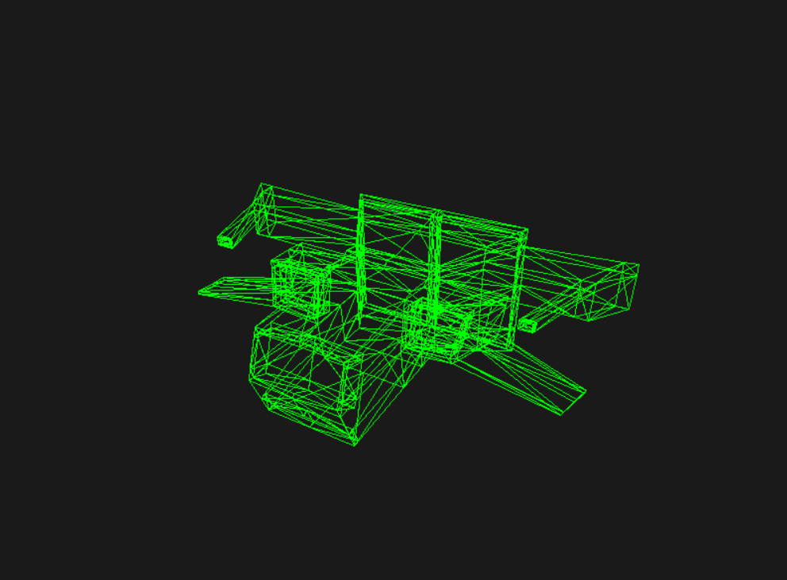

# Lab 6 - Carga de Modelo OBJ

Renderizador de modelos 3D en OBJ escrito en Rust. Soporta dos modos de visualización:

- **Esqueleto**: dibuja únicamente las aristas de cada triángulo (alambrado).
- **Pintado**: rellena cada triángulo con un color celeste agrisado (`Light Sky Blue`).

## Controles

| Tecla | Acción |
|-------|--------|
| `ESPACIO` | Cambiar entre modo automático y manual de rotación |
| `T` | Cambiar entre modo Esqueleto y modo Pintado |
| `←` / `→` | Rotar en Y (modo manual) |
| `↑` / `↓` | Rotar en X (modo manual) |
| `ESC` | Salir |

## Cómo compilar y ejecutar

```bash
cargo build       # Compila en modo debug
cargo run         # Ejecuta el programa
cargo run --release  # Ejecuta en modo optimizado
```

## Repositorio

El código fuente completo está disponible en:

🔗 https://github.com/MagicBag-tab/lab_6_carga_de_modelo

## Modelo renderizado

A continuación se muestra el modelo (`assets/nave_1.obj`) renderizado en modo **Esqueleto**, centrado en pantalla y con un tamaño razonable (aproximadamente el 75% del ancho de la ventana):



## Características implementadas

- Parser de archivos OBJ (vértices y caras)
- Proyección 3D a 2D con matriz de rotación en X y Y
- Rasterización de triángulos con edge functions (funciones de borde)
- Dos modos de visualización toggleables en tiempo real
- Título de ventana dinámico que muestra el modo actual (`[AUTO/MANUAL][ESQUELETO/PINTADO]`)