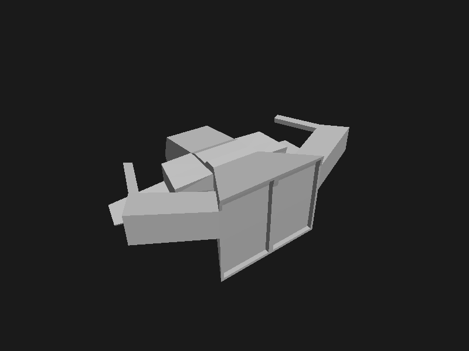

# Lab 6 - Carga de Modelo OBJ

Renderizador de una nave OBJ escrito en Rust con minifb. Incluye rotación automática y manual, y dos modos de visualización:

- **Esqueleto**: dibuja las aristas de todos los triángulos, incluidas las posteriores.
- **Pintado**: rellena las superficies con el color difuso del material MTL y aplica iluminación por cara. Un Z-buffer resuelve la visibilidad. Sin material se utiliza el color base `0x87CEEB`.

## Capturas del visor

Capturas reales del área de dibujo de minifb, a 800 × 600 píxeles. Ambas muestran la misma orientación manual: rotación de 0.55 radianes en X y 0.65 radianes en Y. Para fijar esta vista durante la captura se ajustaron temporalmente los valores iniciales; el programa conserva su inicio habitual en modo automático y esqueleto.

### Modo esqueleto

Permite inspeccionar la triangulación y las aristas de la nave.


### Modo pintado

Muestra las superficies visibles con el material gris del modelo y la iluminación por cara.



## Controles

| Tecla | Acción |
|-------|--------|
| `ESPACIO` | Cambiar entre rotación automática y manual |
| `T` | Cambiar entre esqueleto y pintado |
| `←` / `→` | Rotar en Y en modo manual |
| `↑` / `↓` | Rotar en X en modo manual |
| `ESC` | Salir |

## Compilar y ejecutar

Ejecuta los comandos desde la raíz del proyecto para resolver las rutas de `assets/`.

```bash
cargo build
cargo run
cargo run --release
```

## Visibilidad y materiales

El relleno comparte un Z-buffer entre todas las caras y lo limpia cada fotograma. Con la cámara en `z = 5`, interpola baricéntricamente `1 / (5 - z)` en pantalla: el valor mayor corresponde a la superficie más cercana. Recorta contra una distancia cercana de `0.1` antes de proyectar y limita la rasterización a la ventana. Omite los triángulos degenerados o no finitos.

El OBJ incluido contiene 730 vértices y 1512 caras, todas triangulares. Hay 756 copias geométricas exactas; el cargador conserva una por material, incluso si la copia usa otros índices u otro orden. El archivo OBJ original se conserva.

`assets/nave_1.mtl` define un solo material gris (`Kd 0.8 0.8 0.8`), por lo que este modelo no contiene colores distintos por pieza. El cargador conserva `usemtl` por cara; la iluminación es independiente de la selección de color y del índice del triángulo.

La inspección geométrica detectó 128 caras de área prácticamente nula en el archivo original, incluidas sus copias, 32 aristas con seis incidencias y 32 aristas de dos incidencias con orientación inconsistente. No se reparó la topología del modelo. Se mantienen ambas orientaciones visibles, sin backface culling.

El cargador requiere OBJ triangulados y devuelve un error ante otros polígonos, en lugar de crear abanicos incorrectos sobre caras cóncavas.

## Verificación

```bash
cargo fmt --check
cargo check
cargo test
```

Las pruebas cubren profundidad en perspectiva, independencia del orden de dibujo, ambos órdenes de vértices, recorte cercano, degenerados, caras fuera de pantalla, buffers inválidos, materiales, índices OBJ negativos y cuatro rotaciones de la nave.

Para comprobar visualmente el resultado, ejecuta el visor, pulsa `T`, cambia a manual con `ESPACIO` y usa las flechas para observar el frente, los lados y la parte posterior.

## Repositorio

[Código fuente en GitHub](https://github.com/MagicBag-tab/lab_6_carga_de_modelo)
